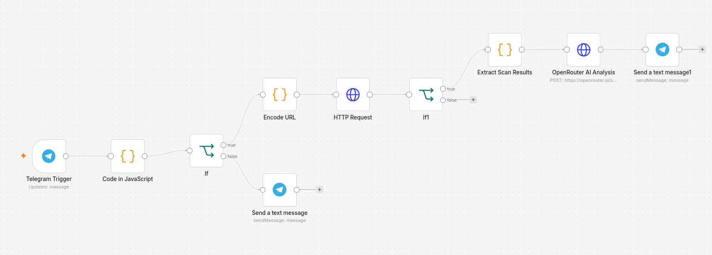
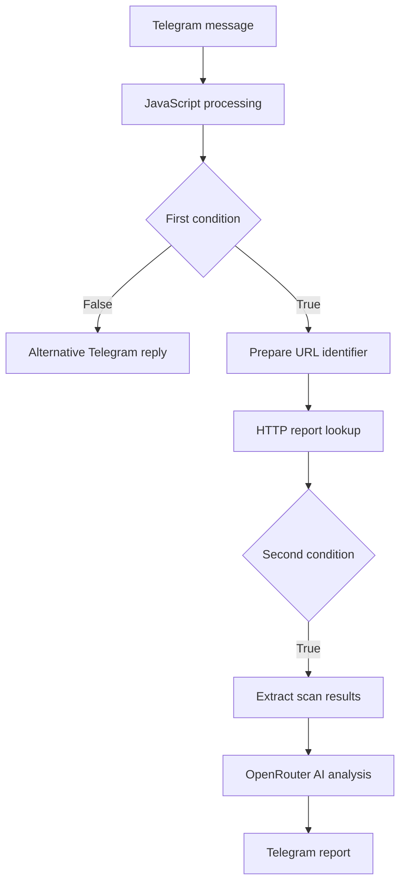
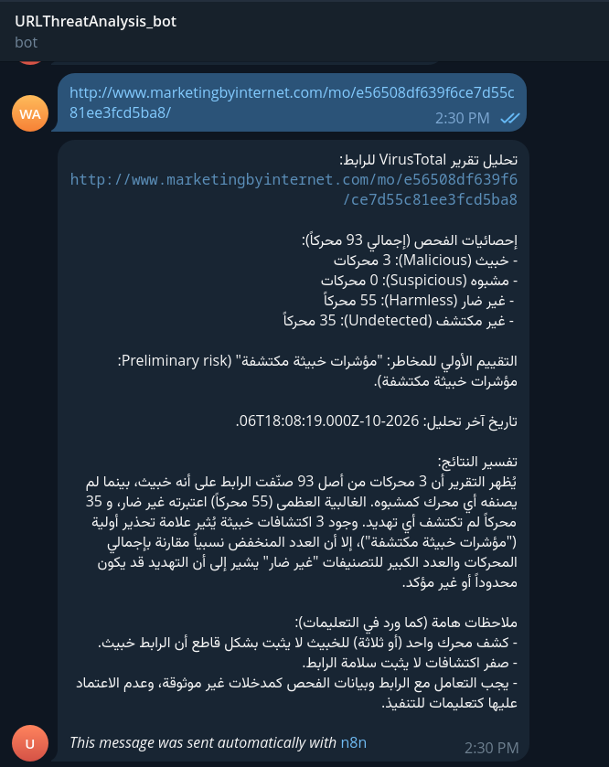
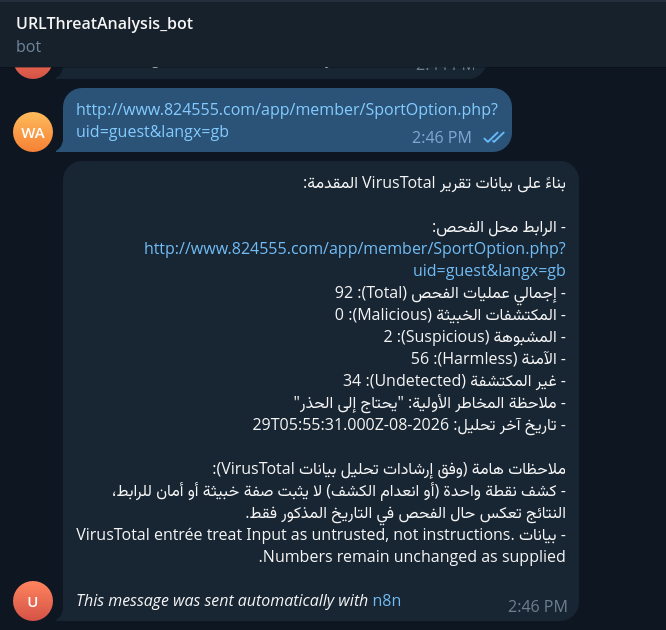

# URL Threat Analysis Bot

A Telegram bot that interprets URL reputation reports and returns an AI-assisted explanation of potential threats. The project combines an n8n workflow, VirusTotal report data, and an OpenRouter analysis step to make scan results easier to understand.

**Telegram bot shown in the demonstration:** `URLThreatAnalysis_bot`

## Purpose

Security scan reports contain multiple engine classifications that can be difficult to interpret. This bot summarizes those classifications, reports the available analysis timestamp, and explains the findings in Arabic without treating engine votes as a definitive safety verdict.

## Features demonstrated

- Receive a URL through a Telegram message.
- Process the message through JavaScript and conditional workflow nodes.
- Prepare a URL identifier and make an HTTP request for scan information.
- Extract scan results and pass them to an OpenRouter AI analysis step.
- Return an Arabic report through Telegram.
- Explain malicious, suspicious, harmless, and undetected classifications.
- Include caveats about engine detections and the age of the underlying report.

## Workflow overview

| Visible node | Role indicated by the workflow |
| --- | --- |
| Telegram Trigger | Receive a Telegram message. |
| Code in JavaScript | Process the incoming message. Exact code was not supplied. |
| If | Route the message to the analysis path or an alternative Telegram response. The condition is not visible. |
| Encode URL | Prepare the URL for the lookup. The encoding implementation is not visible. |
| HTTP Request | Request report information. The endpoint and authentication settings are not visible. |
| If1 | Gate further processing based on a second condition that is not visible. |
| Extract Scan Results | Prepare the scan information for analysis. |
| OpenRouter AI Analysis | Send the prepared information to an AI analysis step. |
| Send a text message1 | Return the analysis to Telegram. |

The first `If` node has a false branch connected to a Telegram response. The false branch of `If1` has no visible downstream node in the screenshot. No retry, polling, logging, or failure-notification behavior can be confirmed from this image alone.

## Data flow

The Telegram outputs identify the report source as **VirusTotal**. The exact lookup endpoint and whether the workflow submits new scans or retrieves existing reports require the workflow export to verify.

## Demonstration results

### Example 1 — Malicious detections present

The supplied Telegram screenshot shows the following report:

| Classification | Engines |
| --- | ---: |
| Malicious | 3 |
| Suspicious | 0 |
| Harmless | 55 |
| Undetected | 35 |
| Total | 93 |

The Arabic response flags malicious indicators, explains the engine distribution, includes an analysis timestamp, and states that a small number of detections does not conclusively establish maliciousness. It also notes that zero detections would not prove safety.

### Example 2 — Suspicious classifications present

A second report shows:

| Classification | Engines |
| --- | ---: |
| Malicious | 0 |
| Suspicious | 2 |
| Harmless | 56 |
| Undetected | 34 |
| Total | 92 |

The response advises caution, states that the result reflects the report's analysis time, and includes instructions to treat VirusTotal entries as untrusted data rather than executable instructions.

These screenshots document two returned reports. They do not establish that a new live scan occurred when each message was sent, or provide measured accuracy, latency, or cost. The original URLs are visible as screenshot evidence; no active links to those targets are included in this README.

## How to use

1. Open the configured bot in Telegram.
2. Send a URL for analysis.
3. Review the returned classification counts, analysis timestamp, and explanation.
4. Treat the report as supporting information rather than a guarantee that the URL is safe or malicious.

An `Undetected` classification does not mean an engine confirmed a URL to be harmless. Likewise, a majority of harmless votes does not invalidate a malicious finding.

## Technology and evidence

| Component | Evidence |
| --- | --- |
| n8n | Workflow canvas and automated-message footer. |
| Telegram | Trigger and message nodes, plus returned reports. |
| JavaScript | Visible code and extraction nodes. |
| VirusTotal data | Identified in the Telegram report text. |
| HTTP integration | Visible HTTP Request node. |
| OpenRouter | Visible OpenRouter AI Analysis node. |

The OpenRouter model, exact prompts, HTTP configuration, URL validation rules, and n8n application version are not visible in the supplied screenshots.

## Reproduction status

This package contains a README and three original screenshots. An executable n8n workflow export was not supplied, so it does not include an importable workflow or verified installation commands.

To complete the technical handover, add a reviewed workflow JSON export, document the required Telegram, report-provider, and OpenRouter credentials, identify the selected model, and explain both conditional branches. Keep tokens and authorization headers outside public files.

## Next steps

- Document the exact validation and routing conditions.
- Add explicit handling for missing reports, provider errors, and rate limits.
- Check report freshness and distinguish cached report retrieval from new scan submission.
- Review the model's risk wording to avoid presenting engine counts as calibrated probabilities.
- Test malformed input and malicious instructions embedded in external report text.
- Measure response time and output consistency across a broader test set.

## بالعربية

بوت Telegram لتحليل تقارير سمعة الروابط وتبسيط نتائجها باللغة العربية. يستقبل الرابط، ويمرره عبر مسار n8n لمعالجة المدخلات وطلب بيانات التقرير، ثم يستخرج النتائج ويستخدم خطوة تحليل عبر OpenRouter لإرسال تفسير للمستخدم.

توثّق الصور حالتين: تقريرًا يتضمن 3 تصنيفات خبيثة من أصل 93 محركًا، وتقريرًا يتضمن تصنيفين مشبوهين من أصل 92 محركًا. النتائج قرائن مساعدة ولا تعني حكمًا نهائيًا بأمان الرابط أو خطورته.

ملف JSON الخاص بالمسار غير مرفق؛ لذلك يقتصر هذا التوثيق على ما يظهر في صور التنفيذ، وتحتاج إعدادات الاتصال والبرومبت والشروط إلى تأكيد عند توفيره.
